<div align="center">


# Andric's Addon

**The do-everything Priest companion for World of Warcraft: Forever.**

Holy, Discipline or Shadow: pick your path and every page follows it. What to cast, what to wear,
where to quest, what to train and everything about the class, in one window that shows you what to do next.

[](https://github.com/ninepointlabs/andrics-addon/releases/latest)
[](#requirements)
[](LICENSE)

**[Website](https://andricsaddon.myazerothlife.com)** ·
**[Install](#install)** ·
**[Features](#features)** ·
**[The Buff Button](#the-buff-button)** ·
**[Commands](#slash-commands)** ·
**[FAQ](#faq)**

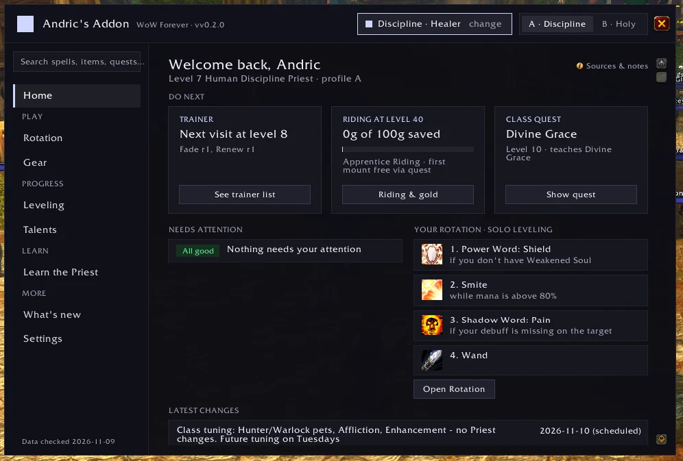

</div>

---

## Contents

- [Install](#install)
- [Getting started](#getting-started)
- [Features](#features)
  - [Home](#home)
  - [The Buff Button](#the-buff-button)
  - [Rotation](#rotation)
  - [Gear: tooltips, bags and where to get it](#gear-tooltips-bags-and-where-to-get-it)
  - [Leveling](#leveling)
  - [Talents](#talents)
  - [Learn the Priest](#learn-the-priest)
  - [What's new and reminders](#whats-new-and-reminders)
  - [Settings, specs and dual spec](#settings-specs-and-dual-spec)
- [Slash commands](#slash-commands)
- [Where the information comes from](#where-the-information-comes-from)
- [FAQ](#faq)
- [The Priest who started it all](#the-priest-who-started-it-all)
- [For developers](#for-developers)
- [License and credits](#license-and-credits)

---

## Install

### Requirements

- **World of Warcraft: Forever** (Interface 16001). Classic Era and retail clients won't load it, by design.
- No other addons needed.

### With OmaForge (Linux)

[OmaForge](https://omaforge.ninepointlabs.com/) installs it and keeps it updated:

```sh
omaforge install -c forever github:ninepointlabs/andrics-addon
```

or search for **andrics** in OmaForge.

### By hand (any OS)

1. Download `AndricsAddon-<version>.zip` from the [latest release](https://github.com/ninepointlabs/andrics-addon/releases/latest).
2. Extract it into your Forever AddOns folder, so you end up with:
   ```
   World of Warcraft/_forever_/Interface/AddOns/AndricsAddon/
   ```
3. Restart the game or type `/reload`.

## Getting started

1. Type **`/andric`** (or `/priest`). The first time, you pick **Holy**, **Discipline** or **Shadow**.
2. Start on **Home**: it tells you what to do next.
3. Optional: bind a key to the [Buff Button](#the-buff-button) under **Settings › Fortitude button › Set key**.

You can change spec at any time with the spec pill at the top of the window. With dual spec, talent
spec 1 and 2 each keep their own profile (see [Settings, specs and dual spec](#settings-specs-and-dual-spec)).

---

## Features

The window has a grouped sidebar (Home · *Play:* Rotation, Gear · *Progress:* Leveling, Talents ·
*Learn:* Learn the Priest · What's new, Settings) with a **search box** that finds any spell, talent,
item, quest or dungeon. Every screen has one sub-tab bar and a **Sources & notes** link that shows
where its information comes from.

### Home

What matters right now, every time you open the window:

- **Do next** cards: what your trainer has for you now (or at your next visit), your savings toward
  Apprentice Riding (100g at 40) and Journeyman Riding (1000g at 60) with a progress bar, and your next
  racial class quest.
- **Needs attention**: missing buffs, upgrades sitting in your bags, unread news and new lessons, each
  with a button that takes you there.
- **Your rotation at a glance**, and the latest changes.


### The Buff Button

A small Power Word: Fortitude button on your screen. **Each press buffs the next friendly player who
needs it**, then the button moves straight on to the next one. Keep pressing until everyone around you
is buffed. Its label shows who's next, and its tooltip says how many are left.

**Who it picks, in order**

1. **You**, if your own buff is missing.
2. **Your group**, nearest first when the game reports distance (party or raid).
3. **Your target**, if it's a friendly player.
4. **Players whose friendly nameplates are showing** (press <kbd>Shift</kbd>+<kbd>V</kbd>): buff the whole town.

**It skips anyone who** already has Fortitude or Prayer of Fortitude, is out of range, dead or offline,
or that you buffed a moment ago (while their buff is still on its way).

**Make it yours:** bind any key under *Settings › Fortitude button › Set key* (or `/andric fort key`).
Shift, Ctrl, Alt and extra mouse buttons work. Drag the small bar above the button to move it, and use
`/andric fort` to show or hide it. It appears as soon as you know Power Word: Fortitude.

**Blizzard's rules, kept:** one press, one cast; the addon never casts on its own. In combat the game
freezes who the button aims at, so it keeps its last pick until combat ends. Buff between pulls.

<table>
<tr>
<td width="50%">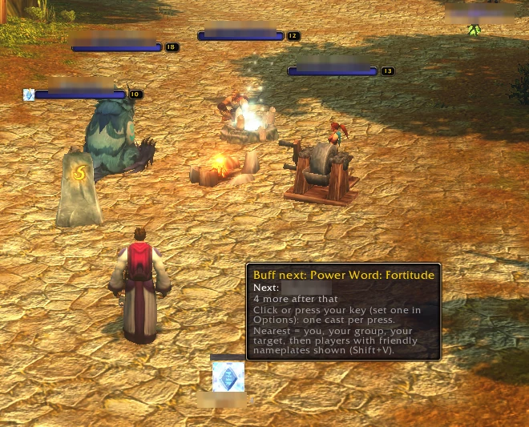</td>
<td width="50%">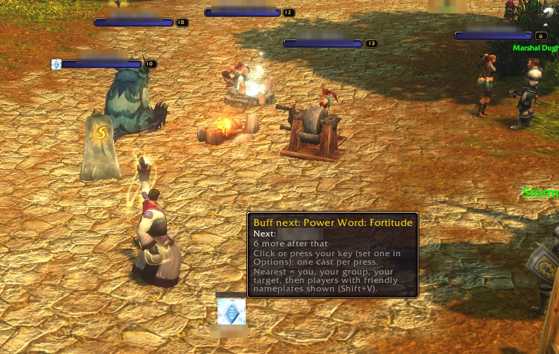</td>
</tr>
<tr>
<td><sub>Hover the button: the tooltip says who's next and how many are left.</sub></td>
<td><sub>One press later: the buff goes out and the button already shows the next player.</sub></td>
</tr>
</table>

<sub>Other players' names are blurred in these screenshots. There's also a
[live demo](https://andricsaddon.myazerothlife.com/#buff) of the picking order on the website.</sub>

### Rotation

- Priority lists for **Solo**, **Dungeon** and **Raid**, for each spec.
- **Only spells you can cast at your level.** Spells your level allows but you haven't trained are
  tagged *Train it*. Spells from talents you haven't taken, and other races' spells, stay hidden until
  they apply.
- An optional **on-screen helper**:
  - For damage, it shows your next spell large, the two after it, and a row of cooldowns.
  - For healing, it shows your priorities and their cooldowns. Who to heal stays your call.
- After each fight, chat gets a short **summary** of what you cast and a tip (for example, finishing
  mobs with your wand so your mana comes back).
- It only ever advises. Nothing is cast for you.

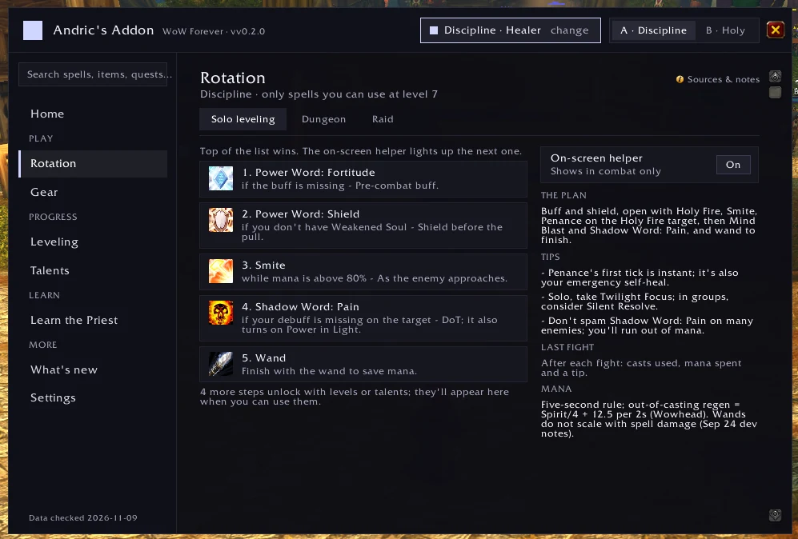

### Gear: tooltips, bags and where to get it

**Item tooltips** compare any item against what you're wearing in that slot, for your spec:

- **UPGRADE** or **Downgrade**, by roughly how much, against your current item, named.
- **What improves** and **What you'd lose**, with what each change means: Intellect as max mana
  and spell crit, Spirit as mana per two seconds, healing as bigger heals.
- **Equip this** when it's an upgrade of at least 1% that you can wear now; otherwise
  "Upgrade once you reach level N".
- Rings and trinkets are compared against the weaker of your two. A two-hander is compared
  against your main hand and off hand together.

**Bags:** upgrades you can wear now get a glow and an arrow on their slot, and a new one gets a
one-time chat line and pop-up. The glow is drawn separately from Pawn's upgrade arrow, so the two
don't overwrite each other.

**The Gear screen** has five views: *For my level*, *Best overall*, *By bracket*, *Consumables* and
*Weights*. *For my level* shows the best recommended item per slot that you can actually get now.
Click one to see:

- **who drops it** and how often, in which dungeon;
- **which quest rewards it**, its level and faction, and who starts it, with coordinates;
- or **how it's crafted**, with the profession, skill and reagents.

**Mark on map** puts a pin and the guide arrow on the quest giver or the dungeon entrance. Entrance
locations come from the game's own map.

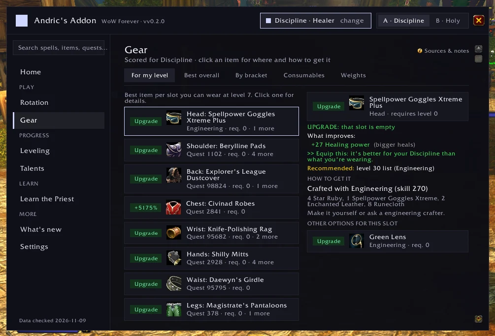

### Leveling

Sub-tabs: **Path** (your next trainer visits and milestones by level) · **Zones & dungeons** (for your
level and faction) · **Trainer** (every spell rank and the level you learn it) · **Class quests** (the
level 4 robe quests and your race's level 10 and 20 class quests, ticked off when done) · **Riding &
gold** (savings goals, your riding trainer, vendor and first-mount quest).

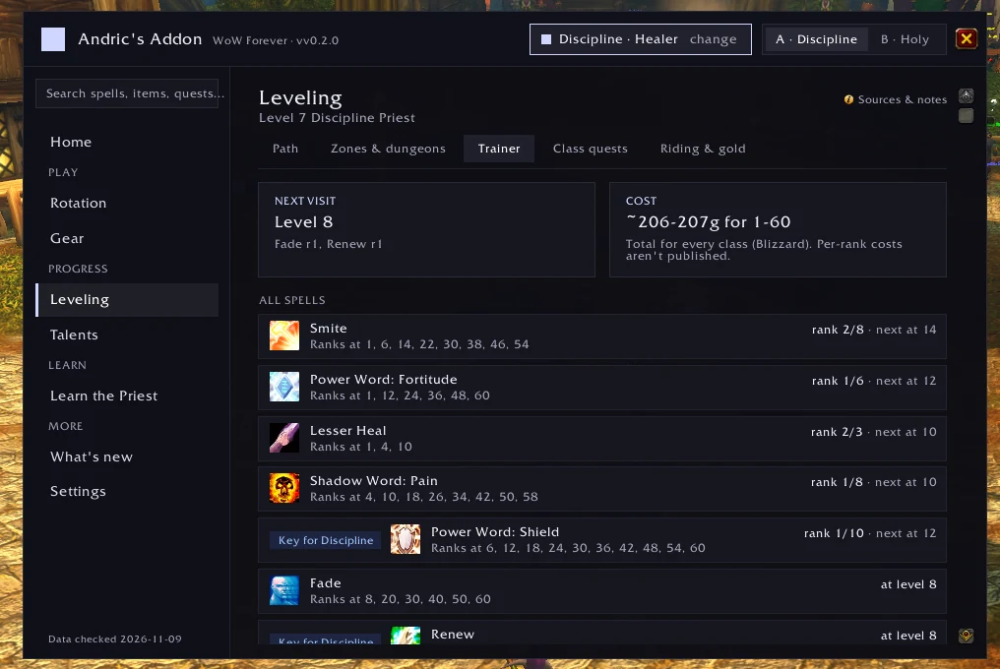

### Talents

Wowhead's recommended **Leveling, Dungeon, Raid and PvP** builds for your spec, **drawn on Forever's own
talent trees**. You see points per talent, the game's tooltip on hover, and a list of what the build
takes. Each build is checked against the current trees, and one that no longer fits shows its link
instead of a wrong picture. Below the builds: what changed for your tree in Forever, and the legacy
talents.

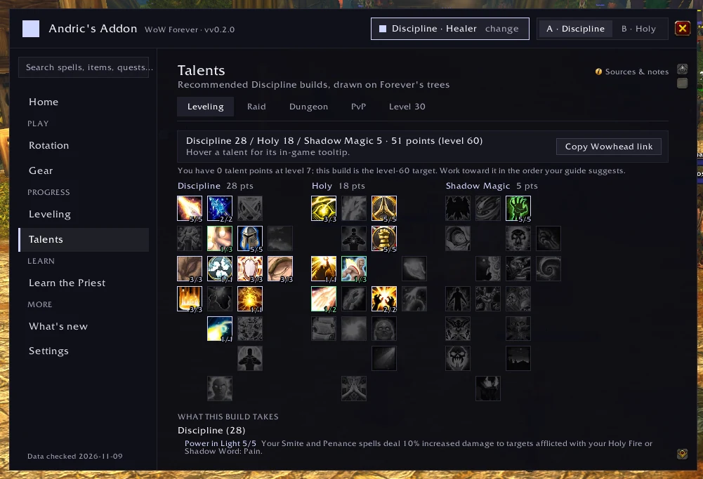

### Learn the Priest

Everything about the class, unlocked as you level:

| Section | What's in it |
|---|---|
| **Lessons** | 35 short lessons that unlock by level, plus a hint the first time you learn a spell |
| **Spells** | All 46 Priest and racial spells: what each does, when to use it, which rank, and how your spec uses it |
| **Talents** | All 40 talents, with what each does and when to take it |
| **How the class works** | Mana and Spirit, the five-second rule, downranking, Weakened Soul, threat, Shadowform and more |
| **In a group** | Healing a dungeon, buffing the group, dispelling, mana breaks, crowd control |
| **Leveling** | Five tips for each spec |
| **Common mistakes** | And how to avoid them |

Anything the sources couldn't confirm is marked as such.

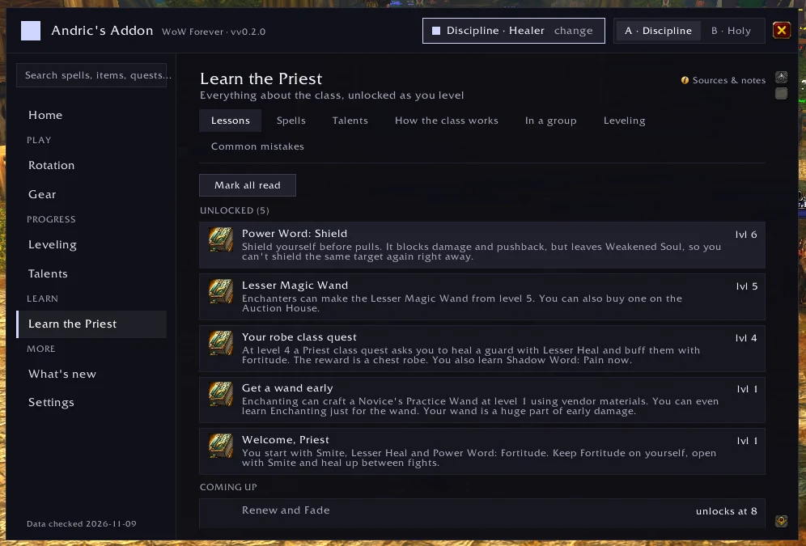

### What's new and reminders

- **What's new** collects Forever and Priest changes, newest first, with an unread count. Addons can't
  go online from inside the game, so new releases carry updated research. An optional
  [companion script](tools/priest-changes-poller/README.md) on your PC can also refresh the list between
  releases from public news feeds.
- **Reminders** for Power Word: Fortitude, Inner Fire, Shadowform (Shadow), your wand and candles appear
  on Home and as a small pop-up out of combat. Choose which ones under *Settings › Reminders*.

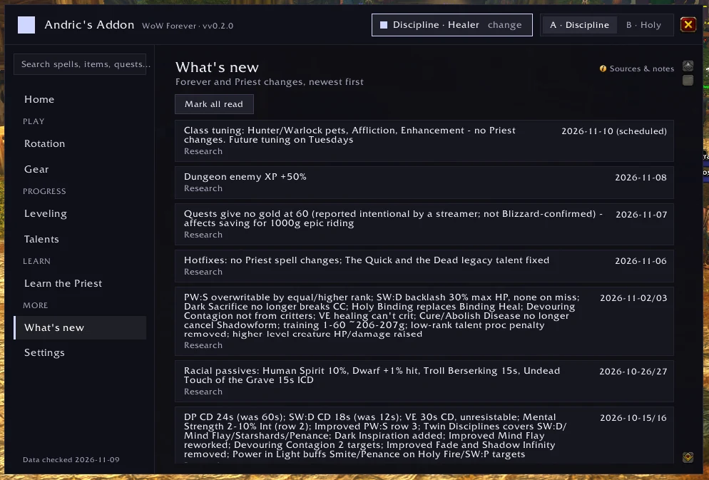

### Settings, specs and dual spec

- **Two profiles per character, A and B**, each with its own spec, gear weights and rotation
  choice. With **dual spec** (learned at level 40), profile A follows talent spec 1 and B follows
  talent spec 2. Swap specs and the addon switches with you. You can also switch by hand from the
  header.
- **Settings** sub-tabs: General · Fortitude button · Tooltips & bags · Reminders · About the data
  (research gaps, conflicts between sources, assumptions, and every source link) · About (version,
  links, credits, and Andric Grammaris, the Priest it's named for).

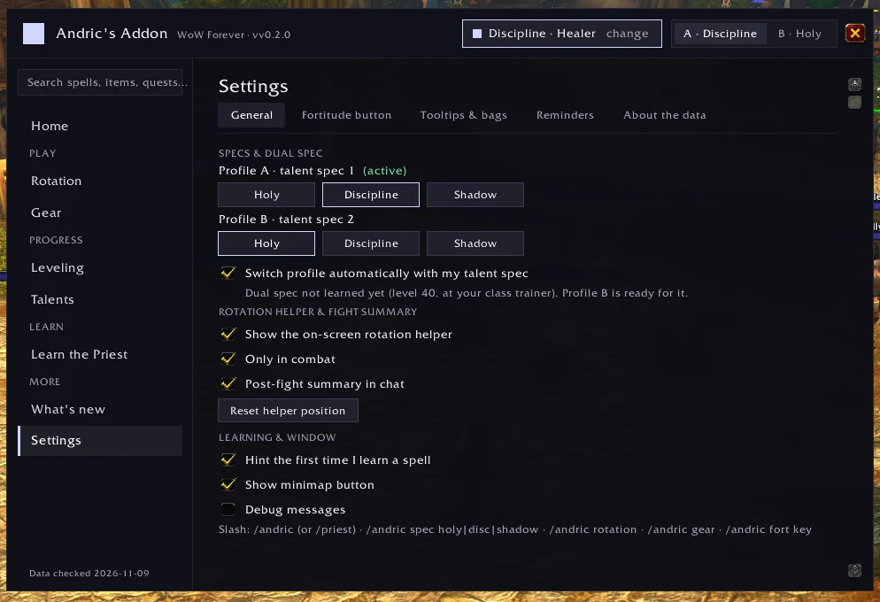

---

## Slash commands

| Command | What it does |
|---|---|
| `/andric` or `/priest` | Open or close the window |
| `/andric spec holy\|disc\|shadow` | Set the spec for the active profile |
| `/andric profile A\|B` | Switch profile |
| `/andric home` · `rotation` · `gear` · `leveling` · `talents` · `learn` · `news` · `settings` | Open a screen |
| `/andric trainer` · `quests` · `riding` · `reminders` · `sources` · `about` | Open a sub-tab directly |
| `/andric fort` | Show or hide the Buff Button |
| `/andric fort key` | Bind a key to the Buff Button |
| `/andric fort debug` | Show what the Buff Button is aimed at and why |
| `/andric hud` | Show or hide the on-screen rotation helper |
| `/andric reset-hud` | Move the rotation helper back to its default spot |
| `/andric remind` | Check your buffs, wand and candles now |

## Where the information comes from

Andric's Addon doesn't make things up. Every fact keeps its source and the date it was checked, and
each screen's **Sources & notes** link lists them.

- **Blizzard:** the Priest class deep dive, the Forever development notes, the hotfix articles, and
  Forever's own UI source, used for game behaviour such as dual spec and map pins.
- **Icy Veins:** leveling and healer guides, class quests, the item and quest database (where items
  drop, quest givers and coordinates) and the Forever talent trees.
- **Wowhead:** talent builds, gear lists for levels 20 and 30, stat priorities, riding and mounts.

Where sources disagree or say nothing yet, the addon says so instead of guessing. That covers, for
example, a few cooldowns and spell IDs, gear lists past level 30, and raid best-in-slot before the
raids open on December 9. The full list is under *Settings › About the data*.

## FAQ

<details>
<summary><b>Does it work on Classic Era or retail?</b></summary>

No. It's built for World of Warcraft: Forever only, and other clients won't load it. Forever's spells,
talents, quests and gear all differ from Classic.
</details>

<details>
<summary><b>Will it play the game for me?</b></summary>

No. Blizzard doesn't allow that. The rotation helper suggests, and the Buff Button casts once per press.
Everything else is information.
</details>

<details>
<summary><b>Why doesn't the Buff Button reach players outside my group?</b></summary>

It can only see players whose friendly nameplates are showing. Press <kbd>Shift</kbd>+<kbd>V</kbd> to
turn them on. `/andric fort debug` shows exactly who it's aimed at and why.
</details>

<details>
<summary><b>Can I put the Buff Button on my action bar?</b></summary>

Not as a macro: Forever's `/click` command won't press addon buttons. Bind it to a key instead under
*Settings › Fortitude button › Set key*.
</details>

<details>
<summary><b>Does it get along with Pawn and other addons?</b></summary>

It has no dependencies. Its bag highlight is drawn separately from Pawn's upgrade arrow, and its
tooltip lines appear alongside other addons' lines.
</details>

<details>
<summary><b>Is this made by Blizzard?</b></summary>

No. Andric's Addon is an unofficial, free and open source fan project by
[Nine Point Labs](https://ninepointlabs.com/). It isn't affiliated with or endorsed by Blizzard
Entertainment.
</details>

---

## The Priest who started it all

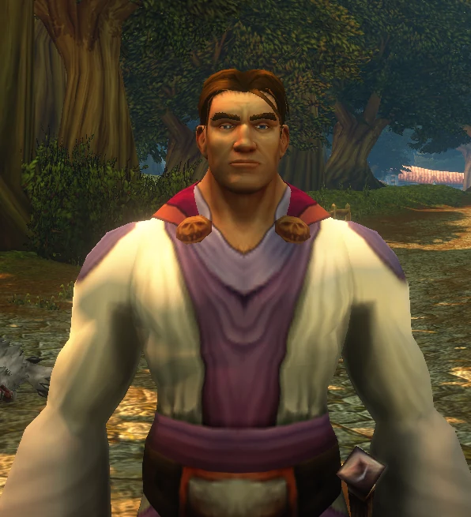

**Andric Grammaris** is the Priest this addon is named for. He set out in Elwynn Forest in Forever's first week
with a robe and more questions than answers: which spells to train, whether that drop was any good, what
a Discipline Priest is supposed to do when the tank runs off.

Andric's Addon is the answer to those questions, built for him and tested on him. Every screenshot in this
README is his.

If you see a Human Priest handing out Fortitude to everyone around him, say hello.

*May the Light guide your heals.*

<br clear="right">

---

## For developers

### Layout

| Path | What's there |
|---|---|
| `AndricsAddon_Forever.toc`, `AndricsAddon.toc` | Addon manifests (Interface 16001) |
| `Core/` | Start-up and the Forever-only check (`WOW_PROJECT_ID == 18`), saved settings with the A/B profiles, specs, dual spec, events and slash commands |
| `Modules/` | Logic: stat parsing and gear scoring, tooltips, rotation engine, fight summary, training, quests and gold goals, reminders, lessons, map pins |
| `UI/` | Window, widget kit, rotation helper, Buff Button, bag highlights, minimap button, and one file per screen in `UI/Panels/` |
| `Data/` | **Generated** Lua data. Don't edit by hand |
| `research/` | Source data: `data.json` (facts, each with source and date), `talents_priest.json`, `item_sources.json`, `sources.md` |
| `content/learn.json` | Teaching text and rotation priorities, sourced and flagged ([format](content/README.md)) |
| `tools/` | Data generator, fetchers, dev install script, and the [change poller](tools/priest-changes-poller/README.md) |
| `tests/` | Headless Lua tests with a strict WoW API mock |
| `docs/` | The [website](https://andricsaddon.myazerothlife.com) (GitHub Pages) |

### Common tasks

```sh
python3 tools/build_data.py            # regenerate Data/*.lua from research/ and content/ (--check to verify)
python3 tools/fetch_talents.py         # refresh Forever's talent trees (Icy Veins calculator data)
python3 tools/fetch_item_sources.py    # refresh where items drop / which quest / how crafted (Icy Veins DB)
lua5.1 tests/run.lua                   # addon tests: every screen and sub-tab, all three specs
python3 tools/priest-changes-poller/tests/test_poller.py
tools/install-dev.sh                   # copy the addon into your Forever AddOns folder
```

CI runs the data check, a Lua syntax check and both test suites on every pull request.

### Releasing

Pushing a `v*` tag runs the [BigWigs packager](https://github.com/BigWigsMods/packager)
(`.github/workflows/release.yml`). It builds `AndricsAddon-<tag>.zip` and a `release.json` that tells
addon managers like OmaForge the zip is for Forever. Before tagging, check that `## Interface` in both
`.toc` files matches the installed client (`omaforge clients`, or in game
`/run print(GetBuildInfo())`).

## License and credits

- Code: [MIT](LICENSE) © Nine Point Labs.
- Information: Blizzard Entertainment, Icy Veins and Wowhead, credited per fact in the addon.
- Screenshots: Andric, in World of Warcraft: Forever. Other players' names are blurred.

World of Warcraft, Warcraft and Blizzard Entertainment are trademarks or registered trademarks of
Blizzard Entertainment, Inc. Game screenshots and icons © Blizzard Entertainment, Inc. Andric's Addon is
an unofficial fan project, not affiliated with or endorsed by Blizzard Entertainment.
